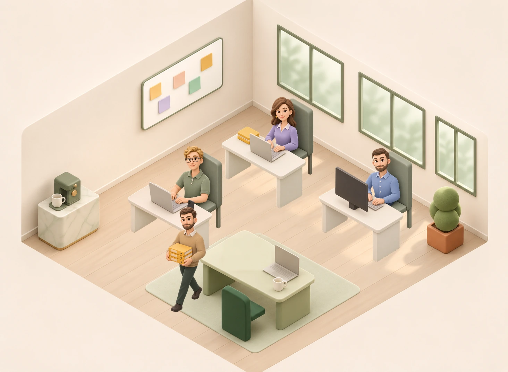

# Visuels du Bureau

Série cartoon 3D accordée à la DA ivoire, crème, sauge et vert profond de l’application. Les références d’origine sont dans [../references](../references).

## Dossiers du bureau vert

Le fond `01-piece-vide.webp` ne contient **aucun dossier sur le bureau vert**.

Le module bureau-ui.js utilise désormais les tâches réelles non terminées (En cours et À valider). Pour réutiliser ces visuels, fournir la liste des tâches en cours : afficher une instance de `13-dossier-tache.webp` par tâche. Zéro tâche signifie zéro instance. Recalculer les instances à chaque changement de cette liste ; les tâches terminées ne gardent pas de dossier. Le compteur de l’aperçu est une simulation locale, pas un branchement au service de tâches.

[Ouvrir l’aperçu autonome](../apercu.html) après téléchargement du dossier (0, 1, 3 tâches et alternance des poses). GitHub affiche son code HTML ; l’ouvrir dans un navigateur depuis une copie locale.

## Fichiers

| Élément | Repos | Frappe | Tête |
| --- | --- | --- | --- |
| Trieur | [02](02-trieur-repos.webp) | [05](05-trieur-frappe.webp) | [06](06-trieur-tete.webp) |
| Développeur | [03](03-developpeur-repos.webp) | [07](07-developpeur-frappe.webp) | [08](08-developpeur-tete.webp) |
| Testeur | [04](04-testeur-repos.webp) | [09](09-testeur-frappe.webp) | [10](10-testeur-tete.webp) |

- [Pièce sans dossiers](01-piece-vide.webp).
- Coursier : [pas gauche](11-coursier-pas-gauche.webp), [pas droit](12-coursier-pas-droit.webp).
- [Dossier d’une tâche](13-dossier-tache.webp), à superposer uniquement si nécessaire.

## Calage et qualité

- 9 postes : canevas identiques de 384 × 480 px, même largeur de bureau et point d’ancrage (192, 462).
- 2 pas : 240 × 480 px, même point d’appui (120, 450) et haut du corps fixe.
- Marges transparentes ajoutées, contours contrôlés sur fonds clair et sombre.
- Les zones fixes des postes sont identiques pixel par pixel ; seules les zones locales des mains ou de la tête changent.
- Les images animées sont encodées en WebP **sans perte** pour préserver cette stabilité.
- Le poids exact des 13 images et leurs empreintes sont dans [manifest.json](manifest.json), sous 1 000 000 octets. L’aperçu composé n’est pas un asset à charger dans l’application.
- La pièce utilise le cadre d’origine ; le manifeste décrit les coordonnées de montage de l’aperçu.
- Images initiales générées avec imagegen intégré ; retouche technique précise par script autorisée par l’utilisateur. [Prompts](prompts.json).
- [Script de préparation de l’application](../../../scripts/make_bureau_images.py) : nécessite Pillow et numpy ; lit les PNG de www/Bureau. Commande : `python scripts/make_bureau_images.py`. Les exports de contrôle de ce dossier utilisent un canevas normalisé distinct.

Ces visuels de référence accompagnent la correction du module Bureau existant. L’application conserve ses fichiers WebP de www/Bureau/webp et sa disposition ; le coursier reste absent de l’interface.
